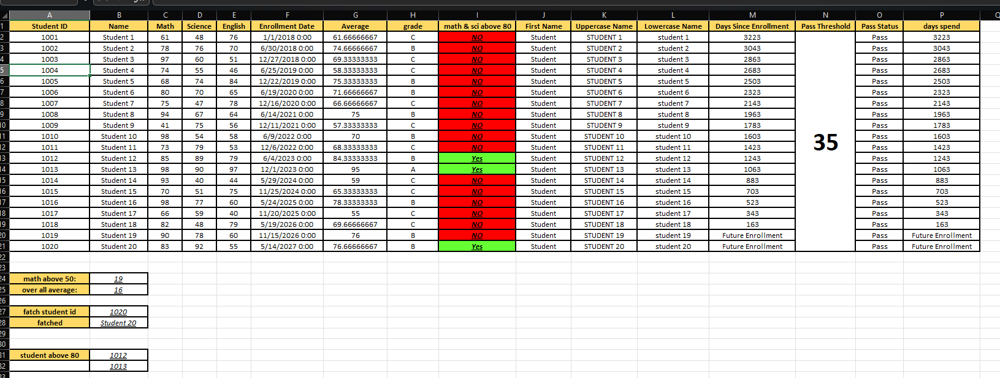
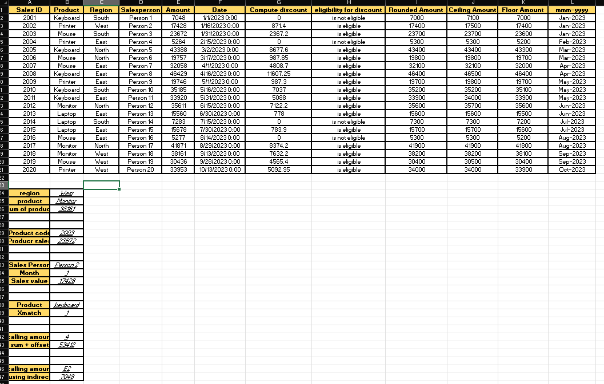
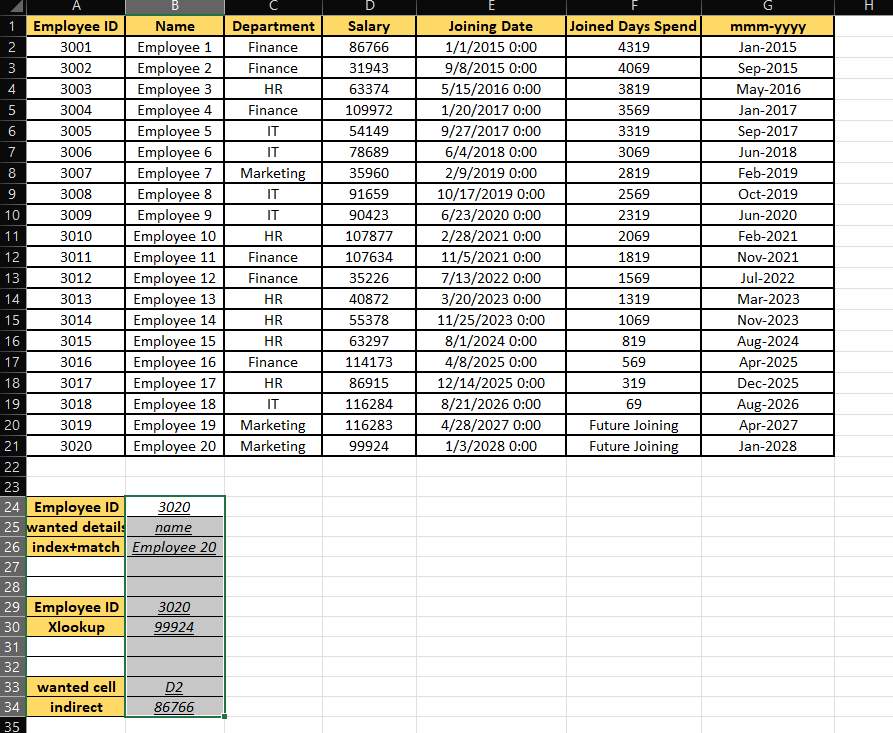

<div align="center">

# 📊 Excel Data Analysis Project

**A hands-on Microsoft Excel project covering formulas, lookups, date calculations and data analysis across student, sales and employee datasets.**


[](https://github.com/dhyeykakadiya71-dotcom/excel-project)

</div>

---

## 📑 Table of Contents

1. [Project Overview](#-project-overview)
2. [Key Features](#-key-features)
3. [Worksheet Details](#-worksheet-details)
4. [Excel Functions Used](#-excel-functions-used)
5. [Technologies Used](#-technologies-used)
6. [Project Structure](#-project-structure)
7. [How to Open and Use the Workbook](#-how-to-open-and-use-the-workbook)
8. [Output Screenshots](#-output-screenshots)
9. [Skills and Learning Outcomes](#-skills-and-learning-outcomes)
10. [Possible Future Improvements](#-possible-future-improvements)
11. [Author](#-author)

---

## 📌 Project Overview

This project demonstrates practical Microsoft Excel skills using **one workbook with three worksheets**:

| Worksheet | Dataset | Records |
|---|---|---|
| `Student_Mark_Sheet` | Student marks and enrollment dates | 20 students |
| `Seles_Detals_Sheet` | Product sales by region and salesperson | 20 sales records |
| `Employee_Data_Sheet` | Employee salaries, departments and joining dates | 20 employees |

The project focuses on **formulas, data analysis, sorting-ready data layout, date calculations, and lookup functions**. Each sheet has a data table at the top and small "lookup panels" underneath where you can change an input (an ID, a product, a cell address) and see the result update.

---

## ✨ Key Features

- 🧮 Formula-based calculations (averages, grades, discounts, rounding)
- 🎓 Student performance analysis with grading and pass/fail status
- 💰 Tiered discount calculation and eligibility checking for sales
- 📅 Date calculations using `TODAY()`, including handling of future dates
- 🔎 Multiple lookup techniques: `VLOOKUP`, `INDEX` + `MATCH`, `XLOOKUP`, `XMATCH`
- 🔗 Dynamic references using `OFFSET` and `INDIRECT`
- 🎨 Colour-coded cells and formatted headers for readability

---

## 📚 Worksheet Details

### 1️⃣ Student Marks Analysis — `Student_Mark_Sheet`

**Data columns:** Student ID, Name, Math, Science, English, Enrollment Date

**Calculated columns:**

| Column | What it does | Formula (row 2) |
|---|---|---|
| Average | Average of the three subject marks | `=AVERAGE(C2:E2)` |
| Grade | A / B / C / D / E / Fail based on the average (≥85 = A, ≥70 = B, ≥55 = C, ≥45 = D, ≥35 = E) | Nested `IF` on `G2` |
| Math & Science above 80 | Returns `Yes` only if both Math and Science are above 80, otherwise `NO` | `=IF(((C2>80)*(D2>80)),"Yes","NO")` |
| First Name | Extracts the first word of the name | `=LEFT(B2,FIND(" ",B2&" ")-1)` |
| Uppercase / Lowercase Name | Converts the name's case | `=UPPER(B2)` / `=LOWER(B2)` |
| Days Since Enrollment | Days from enrollment to today, or `Future Enrollment` | `=IF(F2>TODAY(),"Future Enrollment",TODAY()-F2)` |
| Pass Threshold | A single threshold value (**35**) in a merged cell | `N2:N21` |
| Pass Status | `Pass` if the average meets the threshold, else `Fail` | `=IF(G2>=$N$2,"Pass","Fail")` |
| Days Spend | Same days calculation as Days Since Enrollment | `=IF(F2>TODAY(),"Future Enrollment",TODAY()-F2)` |

**Summary and lookup panel:**

| Task | Cell | Formula |
|---|---|---|
| Students with Math above 50 | `B24` | `=COUNTIFS(C2:C21,">50")` → **19** |
| Students "over all average" | `B25` | `=COUNTIFS(G2:G21,">60")` → **16** *(uses a fixed cutoff of 60)* |
| Fetch student by ID | `B27` → `B28` | `=IFERROR(VLOOKUP(B27,A1:I21,2,FALSE),"-")` → ID 1020 returns *Student 20* |
| Students with average above 80 | `B31:B32` | `=FILTER(A2:A21,G2:G21>80,"No students found")` → **1012, 1013** |

---

### 2️⃣ Sales Data Analysis — `Seles_Detals_Sheet`

**Data columns:** Sales ID, Product, Region, Salesperson, Amount, Date

**Calculated columns:**

| Column | What it does | Formula (row 2) |
|---|---|---|
| Compute Discount | Tiered discount on the amount: 2.5% (≥10,000), 5% (≥15,000), 10% (≥20,000), 15% (≥25,000), 20% (≥35,000), 25% (≥45,000), otherwise 0 | Nested `IF` on `E2` |
| Eligibility for Discount | `is eligible` if the amount is ≥10,000 and a discount applies | `=IF((E2>=10000)*(G2>0),"is eligible","is not eligible")` |
| Rounded Amount | Rounds to the nearest 100 | `=ROUND($E2,-2)` |
| Ceiling Amount | Rounds up to the next 100 | `=CEILING(E2,100)` |
| Floor Amount | Rounds down to the previous 100 | `=FLOOR(E2,100)` |
| mmm-yyyy | Formats the date as month-year (e.g. `Jan-2023`) | `=TEXT(F2,"mmm-yyyy")` |

**Lookup and reference panel:**

| Task | Inputs | Formula | Result |
|---|---|---|---|
| Sum of sales by region **and** product | `B24` = West, `B25` = Monitor | `=SUMIFS(E2:E21,C2:C21,B24,B2:B21,B25)` | **38,161** |
| Sales amount from a product (sales) code | `B29` = 2003 | `=IFERROR(VLOOKUP(B29,A2:E21,5,FALSE),"-")` | **23,672** |
| Sales value by salesperson **and** month | `B33` = Person 2, `B34` = 1 | `=IFERROR(INDEX($E$2:$E$21,MATCH(1,((D2:D21=B33)*(MONTH(F2:F21)=B34)),0)),"-")` | **17,428** |
| Position of a product in the list | `B38` = keyboard | `=XMATCH(B38,$B$2:$B$21,0)` | **1** |
| Sum of first N amounts | `B42` = 4 | `=IFERROR(SUM(OFFSET($E$2,0,0,B42,1)),"-")` | **53,412** |
| Value of a cell given as text | `B46` = E2 | `=IFERROR(INDIRECT(B46),"-")` | **7,048** |

---

### 3️⃣ Employee Data Analysis — `Employee_Data_Sheet`

**Data columns:** Employee ID, Name, Department, Salary, Joining Date

**Calculated columns:**

| Column | What it does | Formula (row 2) |
|---|---|---|
| Joined Days Spend | Days since joining, or `Future Joining` for dates after today | `=IF(E2>TODAY(),"Future Joining",TODAY()-E2)` |
| mmm-yyyy | Joining date formatted as month-year | `=TEXT(E2,"mmm-yyyy")` |

**Lookup and reference panel:**

| Task | Inputs | Formula | Result |
|---|---|---|---|
| Fetch any detail by ID (INDEX + MATCH) | `B24` = 3020, `B25` = name | `=IFERROR(INDEX($B$2:$E$21,MATCH(B24,$A$2:$A$21,0),MATCH(B25,$B$1:$E$1,0)),"-")` | **Employee 20** |
| Salary by ID (XLOOKUP) | `B29` = 3020 | `=XLOOKUP(B29,$A$2:$A$21,$D$2:$D$21,"-")` | **99,924** |
| Value of a cell given as text (INDIRECT) | `B33` = D2 | `=IFERROR(INDIRECT(B33),"-")` | **86,766** |

---

## 🧰 Excel Functions Used

Only functions confirmed in the workbook are listed.

| Function | Purpose | Example from the workbook |
|---|---|---|
| `AVERAGE` | Average of subject marks | `=AVERAGE(C2:E2)` |
| `IF` | Grades, pass/fail, discount tiers, eligibility, future-date checks | `=IF(G2>=$N$2,"Pass","Fail")` |
| `IFERROR` | Show `-` instead of an error in lookups | `=IFERROR(INDIRECT(B33),"-")` |
| `COUNTIFS` | Count rows meeting a condition | `=COUNTIFS(C2:C21,">50")` |
| `SUMIFS` | Sum with multiple criteria | `=SUMIFS(E2:E21,C2:C21,B24,B2:B21,B25)` |
| `SUM` | Total of a range | `=SUM(OFFSET($E$2,0,0,B42,1))` |
| `UPPER` / `LOWER` | Change text case | `=UPPER(B2)`, `=LOWER(B2)` |
| `LEFT` / `FIND` | Extract the first name | `=LEFT(B2,FIND(" ",B2&" ")-1)` |
| `TODAY` | Current date for day counts | `=TODAY()-F2` |
| `MONTH` | Month number from a date | `MONTH(F2:F21)=B34` |
| `TEXT` | Format dates as `mmm-yyyy` | `=TEXT(F2,"mmm-yyyy")` |
| `ROUND` | Round to the nearest 100 | `=ROUND($E2,-2)` |
| `CEILING` | Round up to a multiple of 100 | `=CEILING(E2,100)` |
| `FLOOR` | Round down to a multiple of 100 | `=FLOOR(E2,100)` |
| `VLOOKUP` | Fetch a value by ID | `=VLOOKUP(B27,A1:I21,2,FALSE)` |
| `INDEX` + `MATCH` | Flexible two-way lookup | `=INDEX($B$2:$E$21,MATCH(B24,$A$2:$A$21,0),MATCH(B25,$B$1:$E$1,0))` |
| `XLOOKUP` | Modern lookup (employee salary) | `=XLOOKUP(B29,$A$2:$A$21,$D$2:$D$21,"-")` |
| `XMATCH` | Position of an item in a list | `=XMATCH(B38,$B$2:$B$21,0)` |
| `FILTER` | Return all IDs meeting a condition | `=FILTER(A2:A21,G2:G21>80,"No students found")` |
| `OFFSET` | Dynamic-size range | `OFFSET($E$2,0,0,B42,1)` |
| `INDIRECT` | Reference a cell from text | `=INDIRECT(B46)` |

> ℹ️ `XLOOKUP`, `XMATCH` and `FILTER` require **Excel 2021 or Microsoft 365**.

---

## 🛠️ Technologies Used

- **Microsoft Excel** (workbook: `.xlsx`)
- Excel formulas and functions
- Spreadsheet formatting (header styling, borders, colour fills, merged cell, date formats)

---

## 📁 Project Structure

```
excel-project/
├── excel_project.xlsx        # Main workbook (3 worksheets)
├── student-analysis.png      # Screenshot: Student Marks Analysis
├── sales-analysis.png        # Screenshot: Sales Data Analysis
├── employee-analysis.png     # Screenshot: Employee Data Analysis
└── README.md                 # Project documentation
```

---

## 🚀 How to Open and Use the Workbook

1. **Download or clone** the repository:
   ```bash
   git clone https://github.com/dhyeykakadiya71-dotcom/excel-project.git
   ```
2. Open **`excel_project.xlsx`** in Microsoft Excel (2021 or Microsoft 365 recommended).
3. Use the tabs at the bottom to switch between the three worksheets.
4. Click any calculated cell to see its formula in the formula bar.
5. Try the lookup panels below each table by changing the input cells, for example:
   - Student sheet: change the ID in `B27`
   - Sales sheet: change the region/product in `B24:B25`, or the salesperson/month in `B33:B34`
   - Employee sheet: change the ID in `B24` or the wanted detail in `B25` (`name`, `department`, `salary`, `joining date`)

> 📅 **Note:** Day-count columns use `TODAY()`, so those numbers change every day. The screenshots below were taken on **29 Oct 2026**.

---

## 🖼️ Output Screenshots

### Student Marks Analysis


*Marks, averages, grades, Yes/NO check for Math & Science above 80, name conversions, days since enrollment, pass status, and the lookup/count panel.*

### Sales Data Analysis


*Sales records with computed discounts, eligibility, rounded/ceiling/floor amounts, month-year dates, and the SUMIFS, VLOOKUP, INDEX-MATCH, XMATCH, OFFSET and INDIRECT panel.*

### Employee Data Analysis


*Employee records with days since joining, month-year dates, future-joining handling, and the INDEX+MATCH, XLOOKUP and INDIRECT lookups.*

---

## 🎯 Skills and Learning Outcomes

| Skill | How this project demonstrates it |
|---|---|
| **Spreadsheet data organization** | Clean tables with headers, consistent columns and separate sheets per dataset |
| **Formula-based calculations** | Averages, grades, discounts and rounding done entirely with formulas |
| **Student performance analysis** | Grading scale, pass threshold, and counts/filters on marks |
| **Sales calculations & discount eligibility** | Tiered discount logic and eligibility flags |
| **Employee information retrieval** | Fetching names and salaries by employee ID |
| **Date calculations** | `TODAY()`-based day counts and month-year formatting, with future dates handled |
| **Lookup & reference functions** | `VLOOKUP`, `INDEX/MATCH`, `XLOOKUP`, `XMATCH`, `OFFSET`, `INDIRECT` |
| **Visual formatting** | Colour-coded Yes/NO results, styled headers and bordered tables |
| **Practical problem-solving** | Error-proof lookups with `IFERROR` and multi-criteria searches |

---

## 🔮 Possible Future Improvements

- Replace the manual red/green fills with true **conditional formatting** rules
- Make the "over all average" count use `AVERAGE()` of the class instead of a fixed value of 60
- Add **data validation** drop-downs for the lookup inputs
- Add **charts and a dashboard** (e.g. sales by region, salary by department)
- Add **PivotTables** for department and region summaries
- Add **sorting and filtering** controls to each table

---

## 👨‍💻 Author

**Dhyey Kakadiya**

🔗 GitHub Repository: [github.com/dhyeykakadiya71-dotcom/excel-project](https://github.com/dhyeykakadiya71-dotcom/excel-project)

---

<div align="center">

⭐ If you found this project helpful, consider giving the repository a star!

</div>
